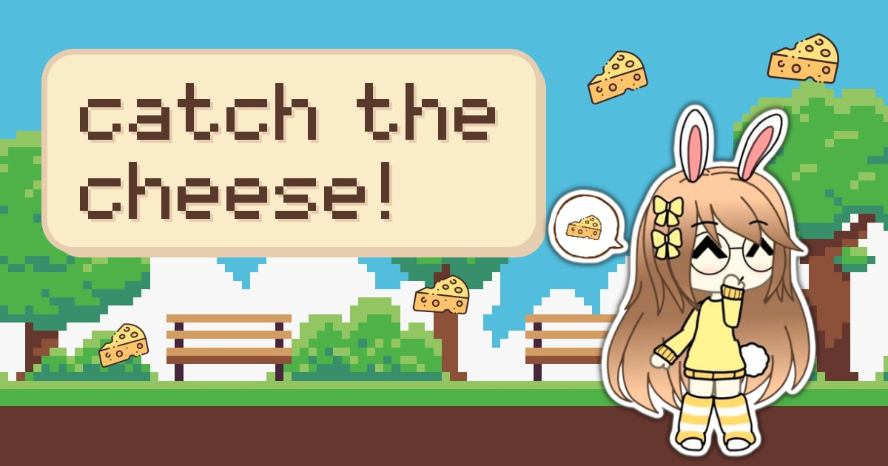

<div align="center">


# catch the cheese!

*a smol html5 game where lily (me lol) catches falling cheese*



[**play it here ↗**](https://justcallmechezz.github.io/projects/catchthecheese/)

</div>

---

## ୨୧ about ୨୧

this is my **first ever html5 game**... that... i made it a few years ago... when i was still new at programming... and honestly its the only one of my games that works correctly at that time... T-T. so now i optimized it... gave a little glow up and uploaded here for everyone to play...

cheese falls from the sky. lily catches it. thats the whole game... yea... just that... nothing else...

```
┊ type      html5 canvas game
┊ made with html, css + vanilla js
┊ best on   phones, portrait view
┊ works as  an installable app (pwa) + offline
```

## ꒰ა how to play ໒꒱

1. open the game on your phone (portrait view pls... the landscape view isnt supported... cuz im lazy ._.)
2. tap **play**
3. touch the left or right side of the screen to move lily
4. catch the cheese 🧀 for points, miss one and u lose a heart
5. lose all 5 hearts and it's game over... but u can always restart ♡

on a keyboard, use the **left** and **right** arrow keys. (well... if u succeed rotating ur monitor 90° if u play on pc... or just use windowed mode then make it look portrait lol...)

```
┊ hearts      lives left, u start with 5
┊ star        ur high score
┊ cheese      cheese catched this round
```

the cheese falls a little faster the longer u survive, so... good luck...

## ⨳゛ install it ◟ヾ

it's a pwa so u can add it to ur home screen and play it like a real app, even offline!

- **android / chrome** → menu → *install app* (or *add to home screen*)
- **iphone / safari** → share → *add to home screen*

## ᡣ𐭩 credits ᡣ𐭩

- game/code by me... **sleepychezz** aka **lily** ♡ → [my site](https://justcallmechezz.github.io)
- music: **Zachz Winner - blu** [NCS Release], music provided by NoCopyrightSounds
  - free download / stream: https://ncs.io/blu
  - watch: https://ncs.lnk.to/bluAT/youtube

---

<div align="center">

(⸝⸝ᴗ﹏ᴗ⸝⸝) ᶻ 𝗓 𐰁

made with ♡ by sleepychezz

</div>
